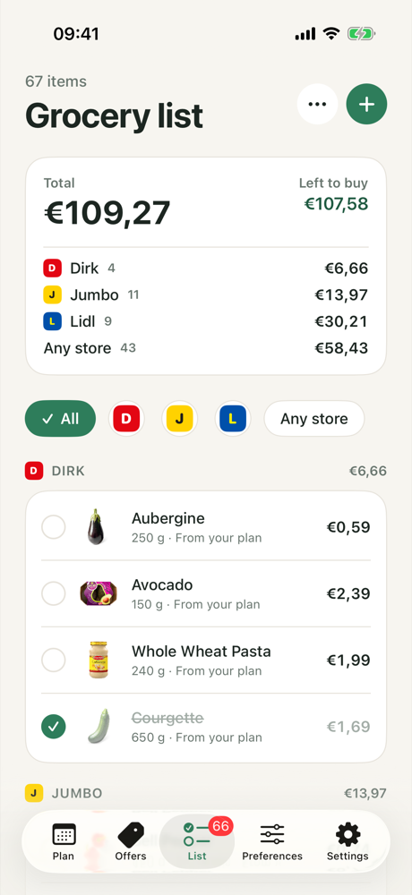
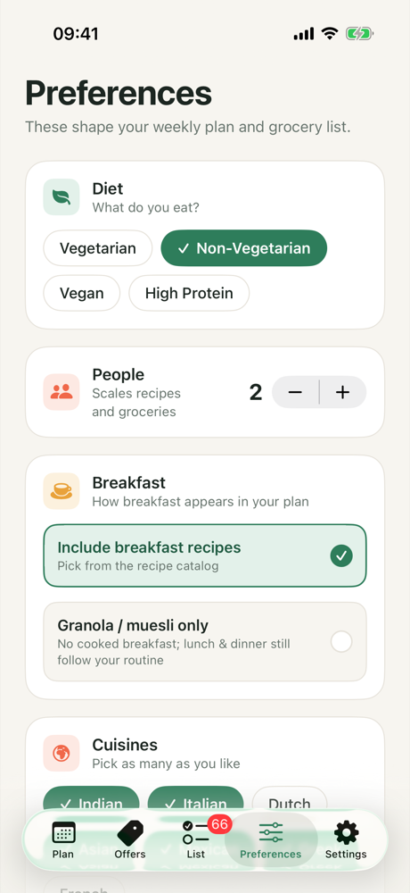
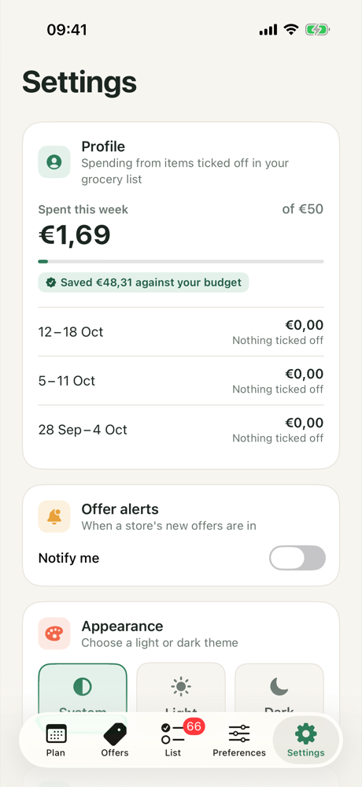

# SmartMealPlanner – iOS (SwiftUI)

**Smart Meal Planner** plans a week of meals around your diet, routine, household and budget, and builds the grocery
list from this week's offers at the Dutch supermarkets near you.

## Screenshots

<table>
  <tr>
    <td align="center"> <b>Launch</b></td>
    <td align="center"> <b>Weekly plan</b> Budget, grocery list &amp; notes</td>
    <td align="center"> <b>Daily meals</b> Day picker &amp; nutrition</td>
    <td align="center"> <b>Recipe</b> Times &amp; amounts for your household</td>
  </tr>
  <tr>
    <td align="center"> <b>Offers</b> Stores within 2 km &amp; AH Bonus</td>
    <td align="center"> <b>Grocery list</b> Per-store totals, tick off</td>
    <td align="center"> <b>Preferences</b> Diet, people &amp; cuisines</td>
    <td align="center"> <b>Settings</b> Spending profile &amp; alerts</td>
  </tr>
</table>

UI designed in Figma: [Smart Meal Planner – UI Revamp](https://www.figma.com/design/mCMW5PlNeirvCva8Ns9EAs)

## Features

### Weekly plan
- **A week of meals in one tap.** Generates 7 days of breakfast, lunch and dinner from 50 built-in recipes (and
  any AI recipes) that fit your diet, cuisines, allergies and dislikes; breakfasts get breakfast dishes.
- **Variety rules.** A dish is never planned twice on one day or more than twice a week; when the recipes run out,
  the slot says so and the notes suggest adding cuisines.
- **Budget card.** The estimated grocery cost against your weekly budget, priced from this week's offers and live
  supermarket prices.
- **Planner notes.** What the planner did: offers used, live prices used, AI recipes added, meals left open.
- **Daily meals and nutrition.** Pick a day to see its meals with photos; weekly calories, protein, carbs and fat.

### Recipes
- **Full recipes.** Real ingredient lists and 6–9 detailed steps with heat levels and timings.
- **Amounts for your household.** Ingredient amounts scale to the number of people you cook for.
- **Total, prep and cook time.** Instead of a step count, so you know how long a dish really takes.
- **Watch on YouTube.** Opens a recipe video search in the YouTube app, or in Safari when the app isn't installed.
- **AI recipe search.** Optional: real recipes from Spoonacular that fit your preferences, adapted by Claude Haiku
  (grams, nutrition, Dutch prices). Without it, Apple's on-device AI writes recipes. Every AI recipe is re-checked
  against your allergies and labelled in the app.

### Offers
- **Deals near you.** This week's offers from the supermarkets within 2 km of your postcode, with real end dates,
  deals such as "1+1 gratis" priced per item, and product photos.
- **Store and category filters.** Store filters show each supermarket's logo.
- **Add to list.** The + on an offer puts it on your grocery list.
- **Albert Heijn Bonus.** AH doesn't share its offers with apps, so the app opens AH's own Bonus page and lets you
  add the deals you want; AH discounts reported by shoppers on Open Prices appear too.
- **Fresh data.** Shows when prices were updated and when each store's next weekly update is due.

### Grocery list
- **One editable list.** Your plan's groceries, offers you added and your own items, grouped by store.
- **Totals.** The overall total, each store's subtotal and what's left to buy.
- **Tick off as you shop.** Ticked items count as spent this week; edit, delete or add items any time.

### Preferences
- **Diet, people, breakfast, cuisines and exclusions.** Everything the planner needs, saved on the first tap.
- **Weekly budget.** From €20 to €150.
- **Accurate location.** A Dutch postcode gives your city, street-level location and the supermarkets within 2 km.
- **Meal routine.** Set breakfast, lunch and dinner to your usual meals, home cooked, flexible or eating out.

### Settings
- **Spending profile.** What you spent this week from ticked-off items, what you saved against your budget, and the
  past three weeks.
- **Offer alerts.** A notification on each chosen supermarket's offer day, when its new offers are in.
- **Appearance.** System, light or dark.

Every feature in detail, screen by screen: [Features](docs/FEATURES.md).

## Documentation

| Document | What's in it |
|---|---|
| [Summary](docs/SUMMARY.md) | What the app does, the problem it solves, highlights, tech stack, roadmap |
| [Features](docs/FEATURES.md) | Every feature, screen by screen |
| [Design](docs/DESIGN.md) | Architecture, project structure, grocery database, recipe search, Supabase, key decisions, design system |
| [API](docs/api/README.md) | The grocery feed API: endpoints, schemas ([OpenAPI](docs/api/openapi.yaml)), download rules, Postman security checks |
| [Test report](docs/TEST_REPORT.md) | Unit, UI, Python, API and function tests, how to run them, and the Google Sheets test case report |

## Getting started

1. Clone the repository and open `SmartMealPlanner.xcodeproj` in Xcode 26 or later (the app targets iOS 26).
2. Select the `SmartMealPlanner` scheme and run on an iOS Simulator.
3. Run the tests with ⌘U (see the [test report](docs/TEST_REPORT.md)).

The app runs without any API keys. AI recipe search (Spoonacular + Claude Haiku) is optional; to turn it on, deploy
the Supabase function as described in [Recipe search](docs/DESIGN.md#recipe-search).

## Author

**Nivedhitha Parthasarathy** — Senior Mobile Developer (iOS / React Native)
