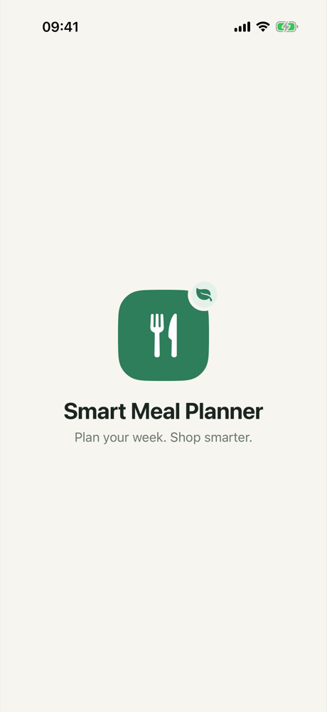
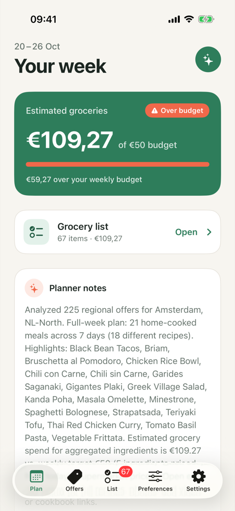
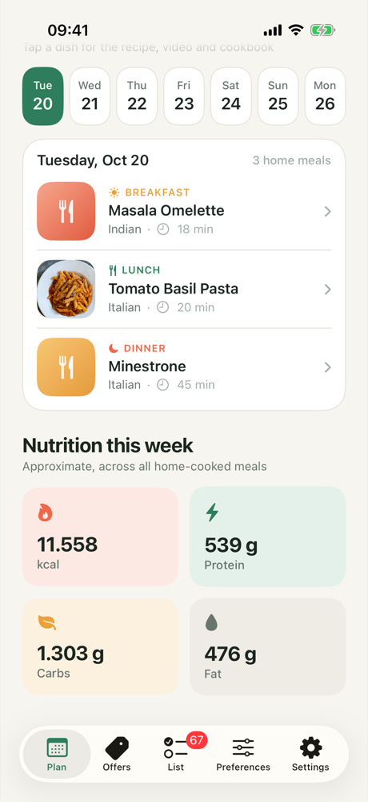
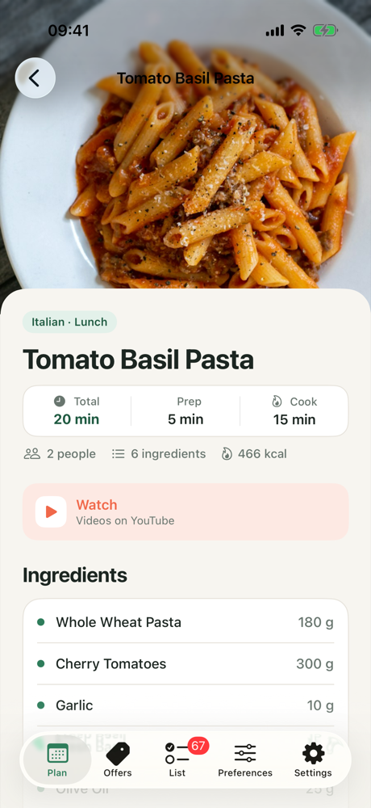
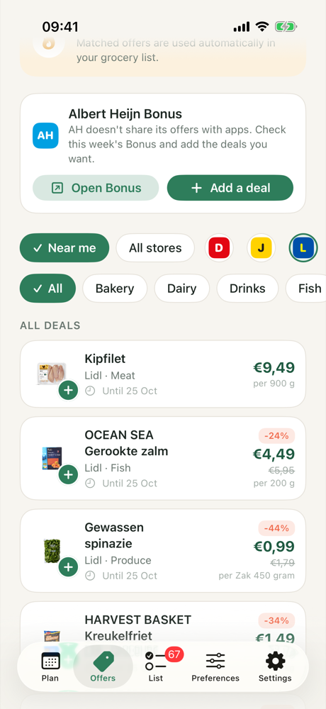
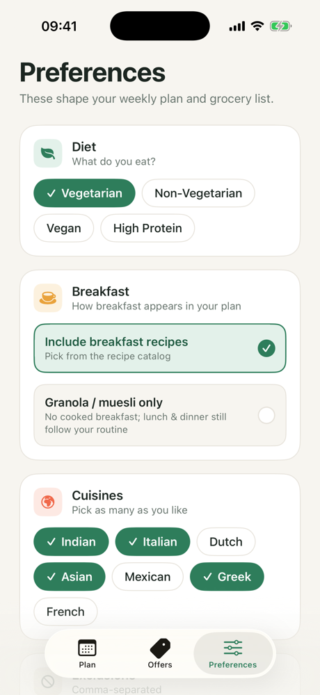

# SmartMealPlanner – iOS (SwiftUI)

[](https://github.com/nivedhitha97/SmartMealPlanner/actions/workflows/swift.yml)

## Project Overview

**Smart Meal Planner** is a SwiftUI-based iOS application designed to generate personalized meal plans based on user dietary preferences, meal routines, and nutritional goals. The project focuses on **clean architecture, scalability, and real-world problem solving**, and serves as a portfolio-quality demonstration of modern iOS development practices.

The app addresses a practical challenge faced by users—planning meals and groceries efficiently while managing nutrition, preferences, and budget—especially in environments with multiple supermarkets and food options.

---

## Screenshots

<table>
  <tr>
    <td align="center"><br/><b>Launch screen</b></td>
    <td align="center"><br/><b>Weekly plan</b><br/><sub>Budget tracking &amp; planner notes</sub></td>
    <td align="center"><br/><b>Daily meals</b><br/><sub>Day picker &amp; weekly nutrition</sub></td>
  </tr>
  <tr>
    <td align="center"><br/><b>Recipe detail</b><br/><sub>Photo, video &amp; cookbook links</sub></td>
    <td align="center"><br/><b>Regional offers</b><br/><sub>Filter deals by category</sub></td>
    <td align="center"><br/><b>Preferences</b><br/><sub>Diet, breakfast &amp; cuisines</sub></td>
  </tr>
</table>

UI designed in Figma: [Smart Meal Planner – UI Revamp](https://www.figma.com/design/mCMW5PlNeirvCva8Ns9EAs)

---

## Key Features

### User Preferences Management
- Supports dietary types (Vegetarian / Non-Vegetarian / Vegan / High Protein)
- Preferred cuisines and ingredient exclusions (allergies/dislikes)
- Breakfast mode: include breakfast recipes, or granola/muesli only
- Weekly grocery budget
- Shopping region derived from a Dutch postcode (city lookup via MapKit, region from the postcode)
- Preferences persisted globally using `UserDefaults`

### Meal Routine Configuration
- Customizable breakfast, lunch, and dinner routines
- Supports fixed, home-cooked, flexible, and outside meals

### Weekly Meal Planning Engine
- Generates a 7-day plan based on:
  - User preferences
  - Meal routine
  - Available recipes
- Intelligent filtering logic to exclude incompatible recipes (diet, allergies, dislikes, cuisines)
- Planner sits behind an `AIPlanningService` protocol, so the on-device heuristic can be swapped for a remote model

### Budget-Aware Grocery List
- Aggregates ingredients across the week into one grocery list
- Matches items to regional supermarket offers and estimates the weekly spend
- Budget card shows progress against the weekly budget

### Regional Supermarket Offers
- Weekly flyer offers filtered by category, grouped into "Ending soon" and other deals
- Discount percentage and total savings

### Settings
- Light / dark theme choice (System, Light or Dark), remembered between launches
- App version and build number

### Nutrition Calculation
- Aggregates nutritional values per week and per recipe:
  - Calories
  - Protein
  - Carbohydrates
  - Fat

### Recipe Data Handling
- Recipes and offers loaded from local JSON files
- Recipe detail with photo, YouTube and cookbook links
- Data modeled using `Codable` for safe and maintainable parsing

---

## Technical Architecture

The application follows a **service-oriented, MVVM-inspired SwiftUI architecture**, emphasizing separation of concerns and testability.

```
SmartMealPlanner
│
├── SmartMealPlanner.swift          App entry point (splash + tab view)
│
├── Models                          Codable data types
│   ├── Recipe.swift, Ingredient.swift, MealPlan.swift
│   ├── MealRoutine.swift, UserPreferences.swift      (incl. UserDefaults load/save)
│   ├── SupermarketOffer.swift, AISuggestedWeekPlan.swift
│   └── DailyMealLog.swift                            (nutrition totals)
│
├── Services
│   ├── AIPlanningService.swift     Planner protocol + on-device heuristic planner
│   ├── PostcodeLocationService.swift
│   └── JSONLoader.swift
│
├── ViewModels                      Screen logic, free of SwiftUI so it can be unit tested
│   ├── PlanningViewModel.swift     Generate / cache / clear the weekly plan
│   ├── MealPlanner.swift           Recipe filtering and meal selection
│   ├── WeeklyPlanContent.swift     Budget card, day picker, slots, grocery list
│   ├── OffersList.swift            Offer filtering, grouping, savings
│   ├── PreferencesForm.swift       Preferences form ↔ saved preferences
│   └── AppSettings.swift           Theme choice, version string, UI-test launch flags
│
├── Views
│   ├── MainTabView.swift, SplashView.swift
│   ├── WeeklyPlanView.swift, RecipeDetailView.swift
│   ├── WeeklyOffersView.swift
│   ├── PreferencesView.swift, MealRoutineView.swift
│   ├── SettingsView.swift
│   └── DesignSystem/Theme.swift    Color tokens and shared components
│
└── Data
    └── recipes.json, offers.json, ingredients.json

SmartMealPlannerTests               Unit tests (Swift Testing), one suite per screen
SmartMealPlannerUITests             UI tests (XCTest) that drive the running app
```

---

## Design & Engineering Highlights

- Implemented global state management using `ObservableObject` and `@EnvironmentObject`
- Encapsulated business logic (filtering, meal generation, nutrition calculation) in a dedicated service layer
- Applied `Codable` best practices, including optional handling and runtime UUID generation
- Ensured SwiftUI preview stability via dependency injection and mock environments
- Kept screen logic in plain Swift types (`PreferencesForm`, `WeeklyPlanContent`, `OffersList`) so views stay thin and the rules are unit tested
- Injected `UserDefaults`, the recipe catalog and the planner into `PlanningViewModel`, so tests run against isolated storage and a stub planner
- Designed the app with extensibility in mind (weekly plans, budgeting, API integration)

---

## Technology Stack

**Platform:** iOS  
**Language:** Swift  
**UI Framework:** SwiftUI  
**Architecture:** MVVM-inspired, Service Layer  
**State Management:** Combine (`ObservableObject`, `@Published`)  
**Data Persistence:** UserDefaults  
**Data Parsing:** Codable (JSON)  
**Location:** MapKit (`MKGeocodingRequest`)  
**Testing:** Swift Testing (unit), XCTest / XCUITest (UI)  
**CI:** GitHub Actions (Xcode 26, iOS Simulator)

---

## Getting Started

1. Clone the repository
2. Open `SmartMealPlanner.xcodeproj` in Xcode 26 or later (the app targets iOS 26)
3. Select the `SmartMealPlanner` scheme and build and run on the iOS Simulator
4. Begin exploration from `SmartMealPlanner.swift` and `MainTabView.swift`

No third-party dependencies are required.

---

## Testing

### Unit tests

Unit tests live in `SmartMealPlannerTests` and use Swift Testing. Each screen's rules are covered without driving the UI:

| Suite | Covers |
|---|---|
| Weekly plan screen | Budget card maths and copy, day picker opening on today, empty-slot labels, grocery preview and checklist |
| Planning view model | Missing preferences / routine errors, generating and caching a plan, restoring it on relaunch, clearing it, planner and catalog failures |
| Plan generation | 7-day structure, diet / allergy / dislike / cuisine filtering, meal-type rules, grocery aggregation, regional offer matching, nutrition totals |
| Recipe detail screen | Calorie estimate, reference links, photo URL handling, meat and animal-product detection |
| Offers screen | Category filter, "Ending soon" grouping, total savings, discount badge, store initials |
| Preferences form / storage | Loading and saving preferences, postcode validation and region rules, older saved data |
| Meal routine screen | Default routine, saving and loading, corrupt data |
| Settings screen | Appearance options and colour schemes, version string, launch flags |
| App icon | Light / dark / tinted icons present and 1024×1024; light icon has no alpha; dark and tinted have transparent backgrounds; dark artwork is bright enough; tinted icon is grayscale with the leaf cut out of the badge |

### UI tests

UI tests live in `SmartMealPlannerUITests` and use XCUITest to drive the running app. Each test launches the app with `-uiTestingResetState` (start with no saved data) and `-uiTestingSkipSplash`.

| Test class | Covers |
|---|---|
| Navigation | Splash screen on launch, every tab opens its screen |
| Weekly plan | Setup checklist, generating before setup, full flow: preferences → meal routine → generate → open a recipe, picking another day |
| Offers & preferences | Filtering offers by category, invalid postcode error, valid postcode shows its region |
| Settings | Version number, System is the default, switching Dark / Light changes the rendered theme (checked from screenshot pixels), theme survives a relaunch, dark theme applies to other tabs |

Run everything in Xcode with **⌘U**, or from the command line:

```bash
xcodebuild test -project SmartMealPlanner.xcodeproj -scheme SmartMealPlanner -destination 'platform=iOS Simulator,name=iPhone 17 Pro'
```

Add `-only-testing:SmartMealPlannerTests` or `-only-testing:SmartMealPlannerUITests` to run one kind. The GitHub Actions workflow builds the app and runs both on every push and pull request to `develop`.

---

## Scalability & Future Enhancements

- Monthly meal planning
- Live supermarket offers (scraped flyers or an API) instead of bundled sample data
- Supermarket price comparison across stores
- Nutrition visualization using Swift Charts
- Backend/API integration (Firebase / Supabase)
- AI-assisted recipe recommendations

---

## Purpose of This Project

This project was built to:
- Demonstrate **production-ready SwiftUI development skills**
- Showcase architectural decision-making and clean code practices
- Solve a real-world problem with a scalable technical approach
- Serve as a professional portfolio project for iOS and mobile engineering roles

---

## Author

**Nivedhitha Parthasarathy**  
Senior Mobile Developer (iOS / React Native)

---

## Notes for Reviewers

This project emphasizes **architecture, maintainability, and real-world applicability** over UI polish alone. It is designed to be easily extendable and suitable as a foundation for larger-scale applications.

